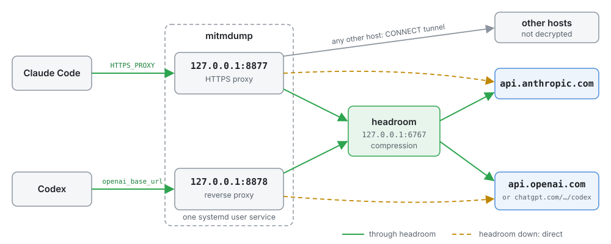
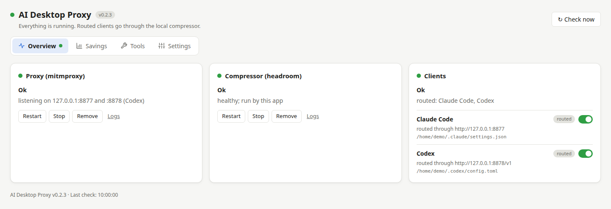

# AI Desktop Proxy

[](https://github.com/redacid/ai-desktop-proxy/actions/workflows/ci.yml)
[](https://github.com/redacid/ai-desktop-proxy/releases/latest)
[](https://github.com/redacid/ai-desktop-proxy/releases)
[](https://github.com/redacid/ai-desktop-proxy/commits/main)
[](https://github.com/redacid/ai-desktop-proxy/issues)
[](https://github.com/redacid/ai-desktop-proxy/stargazers)
[](https://redacid.github.io/ai-desktop-proxy/)


A Linux tray app (Electron) that routes AI coding clients through a local token-compression proxy.

Claude Code Desktop forces `ANTHROPIC_BASE_URL=https://api.anthropic.com`, so a compressor such as
[headroom](https://github.com/headroomlabs-ai/headroom) cannot be set as the base URL. The CLI still honours
`HTTPS_PROXY` and `NODE_EXTRA_CA_CERTS` from `~/.claude/settings.json`. The app uses that. Codex cannot use an
HTTPS proxy, but takes `openai_base_url` in `~/.codex/config.toml`, so the same mitmdump has a second, reverse
listener for it:



What the app does:

- turns routing on and off per client (Claude Code, Codex) by editing only its own keys in the client config,
  and keeps them in place: checks at start, on every file change and on a timer;
- installs mitmproxy and headroom with `uv` (after asking) and runs them as systemd user services;
- shows proxy, headroom and client status plus headroom's savings, and lives in the tray.
- detects RTK and Ponytail per client, offers installation, and checks headroom/RTK/Ponytail updates every six
  hours; installs, updates and RTK hook connections require approval with the exact commands or download steps.

## Install on Linux

On a Linux x64 desktop with systemd (Debian/Ubuntu, Fedora/RHEL or openSUSE), run as your normal user:

```bash
curl -fsSL https://raw.githubusercontent.com/redacid/ai-desktop-proxy/main/install.sh | bash
```

The installer downloads the latest stable GitHub Release, verifies its SHA-256 checksum, and installs the deb/rpm
with its runtime dependencies (sudo is requested). It also installs missing uv/uvx, Node.js/npm, mitmproxy and
headroom. Existing working tools are kept. Optional tools remain selectable in the app. Open **AI Desktop Proxy**
from the applications menu, set up the Proxy and Compressor services, then enable your clients.

Releases must provide `SHA256SUMS` or a SHA-256 asset digest through GitHub. To inspect the installer first:

```bash
curl -fsSL https://raw.githubusercontent.com/redacid/ai-desktop-proxy/main/install.sh -o install.sh
less install.sh
bash install.sh
```

See [Install and update](docs/install.md) for requirements, what the installer does and how to uninstall.

## Quick start (from source)

Requirements: Linux with systemd user services, Node.js 22+, npm, [uv](https://docs.astral.sh/uv/), `ss` (iproute2).

```bash
make install   # npm dependencies and the Electron binary
make run       # build and start the app
```

In the window: **Install mitmproxy**, make sure headroom answers
(**Install headroom** if it does not), then switch **Claude Code** or **Codex** on. Open a new session to use it;
running sessions keep their old settings.

## Documentation

[Illustrated interface tour](docs/interface.md) · [Documentation site](https://redacid.github.io/ai-desktop-proxy/)



The screenshots use demonstration data. The site is published from the released revision after a successful
GitHub Release, once GitHub Pages is enabled in the repository settings.

User documentation (`docs/`, published to the site):

| Document | For |
|---|---|
| [docs/install.md](docs/install.md) | Requirements, installation, app updates, uninstalling |
| [docs/interface.md](docs/interface.md) | Screenshots of every tab and what each control does |
| [docs/user-guide.md](docs/user-guide.md) | Using the app: cards, actions, settings, files, troubleshooting |
| [docs/tools.md](docs/tools.md) | The optional tools and what their buttons change |

Developer documentation (`docs-dev/`, not published):

| Document | For |
|---|---|
| [docs-dev/architecture.md](docs-dev/architecture.md) | How it works: processes, modules, files it writes, safety rules |
| [docs-dev/development.md](docs-dev/development.md) | Building, testing, extending, releases, documentation site |
| [docs-dev/roadmap.md](docs-dev/roadmap.md) | Planned work and deferred headroom integration improvements |
| [AGENTS.md](AGENTS.md) | Instructions for coding agents working in this repository |
| [legacy/README.md](legacy/README.md) | The original shell version (`cdp.sh`), kept for reference |

## Status

Done: Claude Code and Codex clients, mitmproxy service with headroom fallback, headroom service with its options in Settings,
statistics with expandable recent requests, approved tool installation/update checks and RTK client connections, settings,
start at login. Illustrated documentation builds into GitHub Pages on release. GitHub CI validates every push; version tags publish deb/rpm releases. Not yet: package installation smoke tests, Cursor client, macOS.
Planned headroom improvements: diagnostics, quotas, detailed savings, CCR inspection and tuning; see [the roadmap](docs-dev/roadmap.md).

## CI and releases

GitHub Actions runs validation, tests and a build on every push and pull request. A pushed version tag such as
`0.1.0` additionally builds Linux x64 deb/rpm packages and publishes them in a GitHub Release after checks pass.
See [release instructions](docs-dev/development.md#github-ci-and-releases).

Use `make bump` to increment the app version, or `make version VERSION=0.2.0` to also prepare CHANGELOG.md.
GitHub Release descriptions use that version’s changelog section.

Installed builds support app self-updates from GitHub Releases: checks every two hours, optional automatic
background downloads, changelog display and explicit **Update and restart**. Development builds disable updating.
