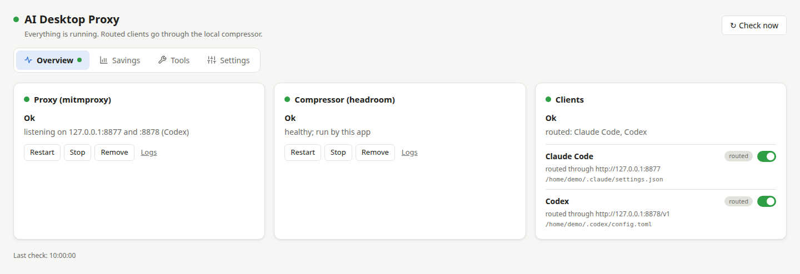

# AI Desktop Proxy

A Linux tray app that routes Claude Code and Codex through a local compression proxy, and manages tools that
help coding agents use less context. Closing the window keeps the app in the tray; proxy services continue
running when you quit it.

[Start with the interface tour](interface.md), or follow the [complete user guide](user-guide.md).

[](images/overview.png)

## Install

Run as your normal desktop user on an x64 Linux distribution with systemd:

```bash
curl -fsSL https://raw.githubusercontent.com/redacid/ai-desktop-proxy/main/install.sh | bash
```

The script downloads the latest stable release, verifies its checksum and installs the deb/rpm with its system
dependencies. It requests sudo for system installation and installs missing uv, Node.js/npm, mitmproxy and headroom.
See [installation details](user-guide.md#installing-a-release) for supported distributions and file locations.

## First run

1. Open **AI Desktop Proxy** from the applications menu.
2. In **Overview**, set up/start the Proxy and Compressor services.
3. Enable **Claude Code** or **Codex**, then start a new client session.
4. Open **Savings** to see what headroom compresses. Use **Tools** to connect optional tools and **Settings**
   to configure ports, headroom, startup and application updates.

Installed builds check for app updates every two hours. Updating is an explicit **Update and restart** action;
see [app self-updates](user-guide.md#app-self-updates).

## Documentation

- [Interface tour](interface.md): annotated explanations of every tab, with screenshots.
- [User guide](user-guide.md): setup, controls, tools, settings and troubleshooting.
- [Architecture](architecture.md): request paths, service ownership and configuration safety.
- [Development](development.md): building, tests, releases, screenshots and this documentation site.
- [Roadmap](plan.md): planned work and deferred integrations.

Screenshots use demonstration data from the actual app renderer. Values, paths and tool versions are examples.
The published site follows the latest successful release; the repository may contain newer unreleased documentation.
