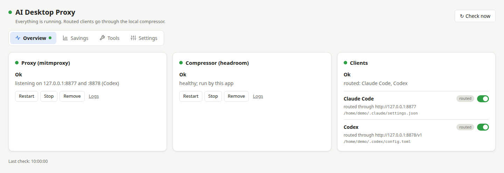
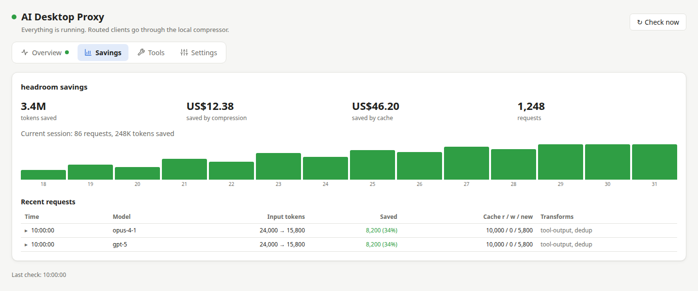
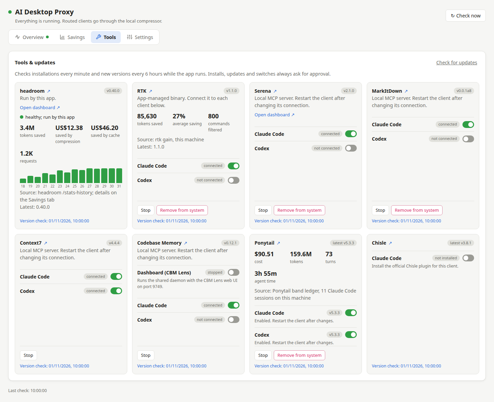
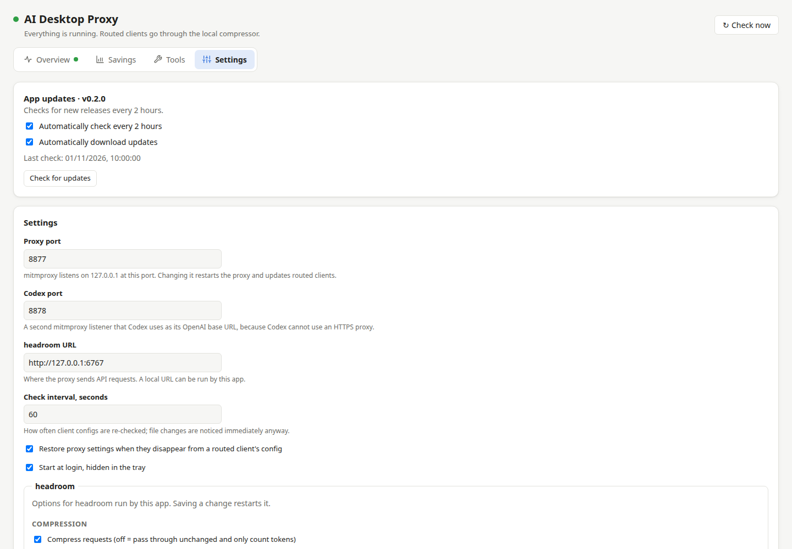

# Interface tour

The four tabs separate daily monitoring from configuration. The dot next to the application title and on
**Overview** reports overall health: green is healthy, amber needs attention, red means a component is down,
and grey means it has not been checked. **Check now** refreshes status immediately.

These screenshots show the real application UI with fixed demonstration data. The `/home/demo` paths, savings
and tool versions are examples, not measurements from your computer. Screenshots were captured in the light theme;
the app also follows your system's dark theme. Select a screenshot to open it at full size.

## Overview: keep the request path healthy

| Area | What it tells you | What to do |
|---|---|---|
| Proxy (mitmproxy) | Whether the proxy is listening, and whether its service matches the current configuration | Install or set up on first use; Apply when outdated; Logs for diagnostics |
| Compressor (headroom) | Whether headroom answers and whether this app manages it | Start the app-managed service; an external service is reported and left alone |
| Clients | Whether Claude Code and Codex are routed through the proxy | Switch a client on, then start a new client session to use the settings |
| Restart / Stop / Remove | Controls for that service | Stop removes client routing before stopping the proxy. Remove also deletes the service unit |

The proxy uses port **8877** for Claude Code and **8878** for Codex by default. headroom normally uses **6767**.
If headroom is unavailable, the proxy forwards directly to the provider without compression.

## Savings: inspect headroom's work

- **Tokens saved** is the lifetime reduction reported by headroom. **Saved by compression** and **saved by cache**
  are distinct estimates: cache savings are not extra compression.
- **Current session** covers the current headroom process; restarting it may reset session figures.
- The bars show tokens saved per day, for up to 14 days. Hover a bar for its date and count.
- **Recent requests** shows provider/model, before/after token counts and the transforms applied. Select a row
  to inspect the request and response when headroom was started with message logging enabled.

Message logging is optional because it retains prompts, code and responses. Read
[the user guide](user-guide.md#recent-requests) before enabling it.

## Tools: connect the right tool to each client

| Control | Meaning |
|---|---|
| Tool name and ↗ | Hover a card for its purpose; ↗ opens its official project page |
| Version badge / Update to … | Installed version and an explicitly approved update when a newer release exists |
| Claude Code / Codex switch | Connects the tool to that client; switches may install/uninstall a plugin or add/remove an MCP registration |
| set up elsewhere | A configuration the app does not manage; its switch is locked |
| Open dashboard ↗ | Opens the tool's own local web UI while it answers |
| Dashboard (CBM Lens) | Starts/stops Codebase Memory's shared daemon with its web dashboard |
| Stop / Start | Deactivates the tool, keeping its installation, where the client supports this |
| Remove from system | Removes app-managed components after confirmation; foreign installations are preserved |
| Version check | When the tool's release registry was last checked, not the last API request |

Tool installations are checked every minute; new tool versions every **six hours**. App self-updates have a separate
**two-hour** cadence. Commands are shown before an install, update or lifecycle action runs.

Statistics have different meanings: headroom and RTK report their own savings; Ponytail's local ledger reports
session consumption, not a measured saving against running without Ponytail. Chisle reports compressed tool output.
See [Tools & updates](user-guide.md#tools-updates) for installation methods and limitations.

## Settings: app updates and connection settings

- **App updates** shows the running app version, last check, and automatic-check/download switches. A downloaded
  release offers **Update and restart**. Development/unpacked builds disable installation.
- **Proxy port**, **Codex port** and **headroom URL** describe the local request path. Saving a port change updates
  client routing and restarts the managed proxy.
- **Check interval** and **Restore proxy settings** control periodic client configuration checks and repair.
- **Start at login** starts the app hidden in the tray.
- **Save** applies the settings form. App-update switches above it are saved immediately.

### headroom options further down the page

[Open the full Settings screenshot](images/settings-full.png) to see the remaining controls.

headroom options configure compression mode, context retrieval, compressors, rate limits, budget, cache, transport
and request-body logging. Defaults add no extra flags. Changes restart the headroom service managed by this app;
settings cannot change an externally managed headroom. See the [option reference](user-guide.md#headroom-options).

## Errors and progress

Errors and the install log remain visible across tabs. Switching tabs does not cancel a tool operation. Closing the
window hides it to the tray; use **Quit** in the tray menu to exit the application.
