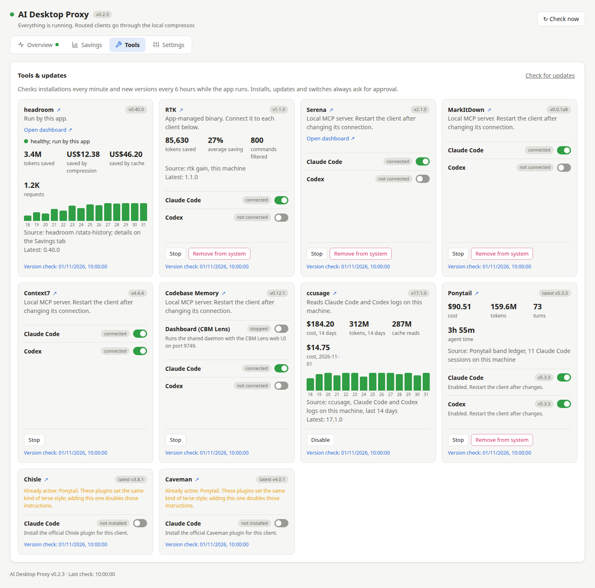

# Tools

The **Tools** tab manages optional tools that help coding agents use fewer tokens. None of them is required: the
proxy and headroom work without them, and a missing tool never turns the app's status red.

## How the tab works

- **Install** appears for a missing tool, **Update to …** when a newer stable version exists. Nothing installs or
  updates by itself.
- Every action first opens a confirmation that lists the exact commands, downloads and file changes. **Cancel**
  changes nothing. Progress and errors appear in the Install log.
- A switch per client (Claude Code, Codex) connects the tool to that client. Restart the client session afterwards.
- **set up elsewhere** means you configured that tool yourself. The app does not change it and locks the switch.
- **Stop / Start** turns a tool off without uninstalling it. **Remove from system** uninstalls what the app
  installed; anything set up outside the app stays.
- Hover a card to see what the tool is for. **↗** next to its name opens the project's page.
- **Open dashboard ↗** appears while a tool's own web dashboard is running.
- The app checks every minute whether tools are installed, and every six hours whether new versions exist.
  **Check for updates** checks right away. **Version check** at the bottom of a card is the time of the last
  version check.

## The tools

| Tool | What it does | Clients |
|---|---|---|
| [headroom](https://github.com/headroomlabs-ai/headroom) | Compresses requests on their way to the provider. Runs as a service, see the Compressor card on Overview | both |
| [RTK](https://github.com/rtk-ai/rtk) | Shortens shell command output before the agent reads it | both |
| [Ponytail](https://github.com/DietrichGebert/ponytail) | Plugin with a terse "lazy senior developer" coding style | both |
| [Chisle](https://github.com/JayPokale/Chisle) | Plugin with terse prose and minimal code, and compresses tool output | Claude Code |
| [Caveman](https://github.com/JuliusBrussee/caveman) | Plugin that makes answers terse: answer first, no filler | Claude Code |
| [Serena](https://github.com/oraios/serena) | MCP server for symbol-level code search and editing | both |
| [MarkItDown](https://github.com/microsoft/markitdown) | MCP server that converts documents (PDF, Office, HTML…) to Markdown | both |
| [Context7](https://context7.com) | MCP server with current library documentation | both |
| [Codebase Memory](https://github.com/DeusData/codebase-memory-mcp) | MCP server that indexes code into a local graph the agent queries instead of re-reading files | both |
| [ccusage](https://github.com/ryoppippi/ccusage) | Reads client logs and reports real token use and cost | — |

### headroom

The card shows the service state and lifetime savings with a 14-day chart; the **Savings** tab has the details.
**Update** installs a specific checked release; a running service managed by the app restarts afterwards, a stopped
one stays stopped. A headroom you run yourself (for example Headroom Desktop) is never touched.

### RTK

The app downloads the official release, checks its checksum and installs it in `~/.config/ai-desktop-proxy/tools/`,
with a link at `~/.local/bin/rtk`. It never replaces another RTK at that path. Make sure `~/.local/bin` comes first in
your `PATH`.

The Claude Code and Codex switches run RTK's own `rtk init`, which adds its hooks and instructions to the client.
The confirmation shows RTK's preview of the changes first. Switching off runs `rtk init --uninstall`; RTK stays
installed. A partial setup shows as not connected; switching it on repairs it. Stopping the proxy does not remove
RTK's hooks.

The card shows tokens saved, the average saving, commands filtered and a 14-day chart, from RTK's own records.
RTK's live view (`rtk gain --watch`) runs in a terminal only.

### Ponytail, Chisle and Caveman

Plugins installed from their official marketplaces with the client's own plugin commands. The switch installs or
uninstalls the plugin for that client. **Stop** disables it in Claude Code; **Start** enables it again. Codex cannot
disable a plugin, so there only the switch applies. Plugins may run their own setup code when installed, as they would
when installed by hand.

- **Ponytail**: modes are set with `/ponytail` in the client. In Codex, review and trust its hooks with `/hooks`; the
  app does not do that for you. The card shows cost, tokens, turns and agent time from Ponytail's own ledger. These
  are what your sessions used, not what Ponytail saved. Until the ledger has a session, the card shows Ponytail's
  published benchmark instead, labelled as such.
- **Chisle**: Claude Code only (its Codex setup edits `~/.codex/AGENTS.md`, which the app does not do). The card
  shows how much tool output its hook removed, with an estimate in tokens.
- **Caveman**: Claude Code only. The app installs only the plugin: Caveman's full installer also starts its own proxy
  on port 8787 and points Claude Code at it, which conflicts with this app. If a Caveman skill from that installer is
  already in `~/.claude/skills/caveman`, the card says so, because the plugin would add a second copy.

!!! note "Use one style plugin"
    Ponytail, Chisle and Caveman all set a terse "say less" style. With more than one active in Claude Code, each
    session carries every set of instructions. Their cards then show a warning, and installing another one adds a
    warning to the confirmation. Keep one and stop the others.

### Serena, MarkItDown, Context7 and Codebase Memory

MCP servers. The switch registers the server in that client at user scope, pinned to a specific release; the client
downloads it on its next start. **Update** moves every connection the app made to the new release.

- **Serena** and **MarkItDown** run with `uvx`. Serena's dashboard appears as **Open dashboard ↗** while it runs
  (each running Serena takes the next port, so there can be several links). Serena has no statistics outside that
  dashboard.
- **Context7** and **Codebase Memory** run with `npx`, so they need Node.js 20.18+. Context7 still asks context7.com
  for the documentation. If Claude Code already has the official Context7 or Codebase Memory plugin, its row shows
  **set up elsewhere**.
- **Codebase Memory** keeps its indexes in `~/.cache/codebase-memory-mcp`; the app never deletes them, so the card
  has **Stop** but no **Remove from system**. Its **Dashboard (CBM Lens)** switch starts a shared background daemon
  with a web dashboard at `http://127.0.0.1:9749/`. The daemon keeps running when the app quits.

**Stop** removes the app's registrations from every client. **Remove from system** for Serena and MarkItDown also
clears their cached download.

### ccusage

ccusage changes no client, so its card has **Enable** and **Disable** instead of switches. When enabled, the app runs
it in the background at most every 10 minutes (each run re-reads all logs for a few seconds). The card shows cost and
tokens for the last 14 days, cache reads and today's cost. These numbers are what you spent, not what the other tools
saved: compare days before and after turning a tool on.

## What Remove from system does

| Tool | Stop (keeps it installed) | Remove from system |
|---|---|---|
| RTK | Disconnects RTK from every client | Stop, then delete the app's RTK binary and its `~/.local/bin/rtk` link. RTK installed elsewhere is refused. Savings history stays |
| Serena, MarkItDown | Removes the app's registration from every client | Stop, then clear the cached download |
| Context7, Codebase Memory | Removes the app's registration from every client | — |
| Ponytail, Chisle, Caveman | Disables the plugin in Claude Code | Uninstall from every client, then remove the official marketplace. A marketplace of the same name from another source stays |

## When a check fails

GitHub rate limits, no network, or an unexpected client CLI version can make a check fail. The card shows the error
and keeps the last known version; an unknown state is never treated as "not installed". If an action fails halfway,
read the Install log: earlier steps may already have run.
